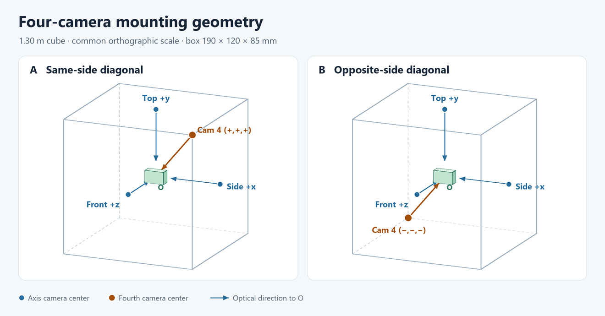

# 네 시점 강체 추적의 통합 제안

## 배치 A/B

중심 O를 원점, 측면·상단·정면 카메라 중심을 각각 (+x,+y,+z) 축 쪽에 둔다. 이 세 카메라를 roll/pitch/yaw라고 부르더라도 각 카메라는 영상에 나타나는 모든 병진·회전에 공동으로 반응한다. 비교 A는 (+,+,+) 꼭짓점에서 O를 향하고 B는 (−,−,−)에서 O를 향한다. 꼭짓점 위치와 광축 방향은 부호가 반대다. 프레임 한 변이 s이고 마운트가 꼭짓점에 붙으면 각 좌표의 절댓값은 s/2, 중심까지 거리는 √3 s/2이다. 실제 마운트가 안쪽으로 들어간 만큼 외부 보정으로 측정한다.

공간 대각선 단위벡터의 성분은 1/√3이다. 세 양의 **축선**과의 예각은 각각 54.74°이며 수평 투영의 방위각은 45°, 수평면에서의 고도각은 35.26°다. 세 축 모두와 정확히 45°인 단위 벡터는 존재하지 않는다. 한 축 카메라의 광축과 대각 카메라 광축 사이 유향각은 A에서 54.74°, B에서 125.26°다. 중심에서 두 각의 사인값이 같으므로 단순히 각도가 더 크다는 이유로 깊이 정밀도 우위를 예측할 수 없다. 실제 비교에는 두 카메라에 공통으로 보이는 점이 필요하다.

| 이상적 정렬 정지 상태 | A 같은 쪽 | B 반대쪽 |
|---|---:|---:|
| 한 번 이상 보이는 꼭짓점 / 8 | 7 | 8 |
| 두 시점 이상에서 보이는 꼭짓점 / 8 | 7 | 7 |
| 한 번 이상 보이는 모서리 / 12 | 9 | 12 |
| 두 시점 이상에서 보이는 모서리 / 12 | 9 | 9 |
| 세 시점 이상에서 보이는 모서리 / 12 | 3 | 0 |

이 계산은 중심에 놓은 축 정렬 불투명 상자, 면 중심 축 카메라, 화면 잘림과 외부 가림이 없는 경우다. 모서리에 접한 두 면 중 앞면 하나 이상이 보이면 그 모서리를 센다. 축 카메라 세 대는 각자 한 양의 면을 보고, A는 같은 세 면, B는 세 음의 면을 본다. B에서 새로 보이는 뒤쪽 꼭짓점과 세 모서리는 이 자세에서는 한 시점에서만 보인다. 모델 투영 추적은 그 단안 증거도 사용할 수 있다. 두 시점 선 삼각측량은 공통으로 관측한 모서리에서만 가능하다. 회전한 상자와 손이 들어온 장면의 실측 결과는 이 표와 달라질 수 있다.

**배치 선택은 목표별로 진행한다.** 명시적 다중 시점 대응의 반복 확인에는 A의 중복 관측이 유리할 수 있다. 손이 세 양의 면을 동시에 가리는 작업에서는 B의 반대편 시야가 남을 수 있다. 작업자의 손이 B의 광축을 먼저 막거나 프레임 기둥·테이블이 음의 꼭짓점 시야를 막으면 이득이 사라진다. 실제 프레임에서 양 배치를 각각 외부 보정한 뒤 같은 자세 지그, 일치하는 촬영 설정, 같은 방향의 손 접근과 역방향 접근을 반복한다. 독립 자세 기준으로 위치·회전 오차, 유지율, 재획득 시간, 픽셀 크기, 특징별 가시 카메라 수, 조건수를 비교한다. 동작 반복 차이는 배치 차이와 함께 기록한다.

## 모듈 경계와 전달 규약 제안

### 손 접근 방향에 따른 비교 결과

1.30 m 정육면체와 190 × 120 × 85 mm 상자를 가정한 81개 합성 자세에서, 두 시점 이상이 동시에 볼 수 있는 모서리 위 표본의 비율을 계산했다. 같은 손 크기와 접근 경로를 중심에 대해 반전시켰다. 아래 값은 가시성 지표이며 자세 오차는 별도의 추적 실험에서 측정한다. [실험 설정·원시 결과](../experiments/mount_occlusion/README.md)

| 손을 근사한 구의 위치 | A 같은 쪽 | B 반대쪽 | 이 조건에서 더 높은 배치 |
|---|---:|---:|---|
| 가림 없음 | 89.71% | 97.63% | B, 7.92%p |
| 세 축 카메라가 있는 쪽 (+++) | 82.20% | 97.52% | B, 15.32%p |
| 맞은편 (−−−) | 89.71% | 83.65% | A, 6.06%p |

손이 주로 세 축 카메라 쪽에서 들어오고 반대편 아래 꼭짓점에서 작업 영역까지 시야가 확보되면 B를 첫 실물 시험 배치로 삼을 근거가 있다. 반대편에서 손이 접근하는 작업에서는 이번 실험의 순위가 역전됐다. 실제 손가락의 형태, 손목 방향, 받침대, 배경, 반사와 검출 품질은 이 가시성 계산에 포함되지 않았다.

### 실제 프레임에서의 배치 검증

1. A와 B의 렌즈 중심부터 작업 공간 중심까지 거리와 렌즈 초점·해상도를 기록한다. 꼭짓점 카메라는 면 중심 카메라보다 √3배 멀리 있으므로 같은 초점거리에서 상자가 작게 투영된다. 대각 카메라를 옮길 때 프레임의 하단 바, 책상과 케이블이 시야를 가리는지 작업 공간의 중앙과 여덟 경계 위치에서 확인한다.
2. B에서는 단면 체커보드 뒷면을 볼 수 있다. 모든 카메라가 한 번에 같은 보드 앞면을 보게 강제할 필요는 없다. 서로 겹치는 카메라 쌍마다 여러 보드 자세를 수집해 연결된 외부 보정 그래프를 만들고, 각 촬영에서 보드를 공유하는 카메라들의 재투영 오차를 공동 최소화한다. 두 면을 이용하는 타깃은 앞뒤 좌표계의 상대 변환을 실측한다. 별도 보드 자세를 남겨 배치별 교차 검증한다.
3. 상자 중심과 축을 재현하는 지그에서 축 정렬, 사선, 모서리가 짧게 투영되는 자세를 반복한다. 손은 세 축 카메라 쪽과 반대쪽에서 각각 접근한다. 기준 자세 평가용 표식이 추적 입력에도 들어가면 marker-assisted 조건으로 기록한다. 시야 밖·자기 가림·손 가림·잘못된 할당을 따로 표기하면 실패가 배치에서 왔는지 검출에서 왔는지 추적할 수 있다.
4. 종단 지연은 프레임의 정렬 기준 시각부터 자세가 소비 가능해질 때까지 측정하고 처리율 및 지연 p50/p95를 별도로 보고한다. 단일 영상 분할 속도에서 네 스트림의 실시간 성능을 추정하지 않는다.

| 레코드 | 필드와 의미 |
|---|---|
| Rig | schema_version, rig_id, calibration_id, camera_id, width/height, K, distortion_model/coefficients, T_camera_world(4×4), 보정 해상도. 세계·물체 좌표는 오른손계, 길이 m, 카메라 좌표는 x 오른쪽·y 아래·z 전방 |
| Model | object_id, model_version, 치수 m, vertex_id와 모델 3D 좌표, edge_id와 양 끝 vertex_id, 인접 면/바깥 법선, 허용 대칭 변환, 옵션 marker_id와 T_object_marker |
| Observation | session_id, camera_id, source_frame, host_monotonic_ns, aligned_time_ns와 시간 불확실성, pixel_space, calibration_id, object_track_local_id, observation_id, point 또는 segment의 픽셀 좌표·공분산·검출 점수·valid·실패 이유. mask/edge 경로는 선택 |
| FrameGroup | 기준 시각, 참여/누락 camera_id 집합, 각 시각차, 시간 정렬 정책. 초과한 관측은 사유를 기록하고 제외 |
| Association | observation_id, candidate_model_id, 가설 ID, 할당/미할당, 잔차, 지지 구간, 가중치. 경쟁 후보와 등가 대칭 분기를 표현 |
| Pose | T_world_object, 시각, measured/predicted/lost, 사용 카메라와 특징, 잔차 분포, 랭크, 불확실성, 대칭 분기, 재초기화 이벤트. GT는 평가기만 읽는 별도 스트림 |

현재 recorder의 CSV와 분할 frames.jsonl은 source_frame으로 연결하되 실제 녹화의 세션·슬롯 정보를 추가한다. 과거 결과 중 타임스탬프가 없는 프레임은 미상으로 표시한다. 동기화 완료 전에는 서로 다른 동영상의 같은 프레임 번호를 한 그룹으로 묶지 않는다. ROI와 리사이즈 좌표를 원본 픽셀로 역변환한다. 왜곡 원본 픽셀의 곡선 모서리는 왜곡 제거 후 직선 비교하거나 왜곡 모델로 투영한 곡선과 비교한다.

## 향후 확장과 판정

- 3-of-4는 네 개의 3대 부분집합에서 각각 자세를 구해 제외 카메라의 독립 재투영 지지까지 비교한다. 한 시점 누락이나 오보정에 대한 민감도와 처리 시간을 함께 평가한다.
- 동일 물리점의 신뢰할 수 있는 3D 대응이 세 개 이상 비공선으로 확보되면 중심을 빼고 교차 공분산 SVD로 회전을 구한다. det(R)=+1로 보정하고 중심 차로 병진을 복원한다. 이를 공동 SE(3) 재투영 최적화의 초기값으로 사용할 수 있다.
- 카메라별 지지율·가림·정규화 잔차·시간 오차를 먼저 명시적 가중치로 평가한다. 학습 후보에는 카메라의 순서에 무관한 Deep Sets 집계 또는 자세 가설을 query로 하는 cross-attention을 사용할 수 있다. 외부 보정과 유효 마스크를 입력하고 촬영 세션 단위로 학습·검증을 나눈다. 모든 카메라가 불량한 경우도 거부하도록 절대 품질 신호를 유지한다. [Deep Sets](https://arxiv.org/abs/1703.06114)
- 팀 결정이 필요한 사항은 상자 치수·표면 대칭, 마커 허용 및 초기화/평가 전용 사용 여부, 독립 지그 정밀도, 시간 정렬 허용치, 실시간 목표 FPS와 종단 지연, 손 접근 방향, 대각 마운트의 물리적 간섭이다. 한 대 고정, 품질 기반 한 대 선택, 축 세 대, A/B 네 대를 동일 조건에서 평가한 뒤 최종 구성을 선택한다.

실험 구현과 수치는 [합성 실험](../experiments/fusion/)에서 확인한다. 제안 인터페이스는 기존 파일을 읽는 후속 어댑터의 계약이며 실물 파이프라인에 대한 변경은 별도 통합 단계다.
