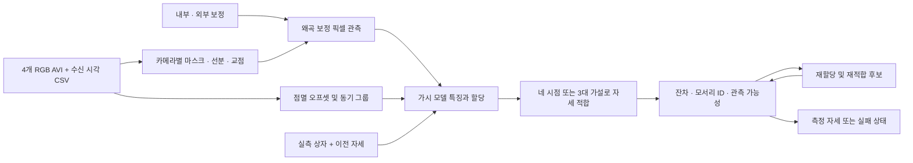

# 한 번의 측정이 만들어지는 과정

아래는 **개념도**다. 화살표는 데이터 의존 관계를 표시한다. 전체가 실제 네 대에서 실시간으로 통합 검증됐다는 의미는 아니다.

한 시점의 입력에는 카메라 ID, 원본 프레임 번호, 픽셀 좌표계, 보정 버전과 유효 시간이 필요하다. 동일 번호 프레임이라도 실제 촬영 시각이 다를 수 있다. group에서 카메라 하나가 누락되면 해당 슬롯을 비워 두고 동기화되지 않은 프레임으로 채우지 않는다. 신뢰할 만한 출력에는 자세와 함께 **언제, 어떤 시점, 어떤 특징에서 계산했는지**를 남긴다. [프레임 정렬](../../rig/synchronize.py) · [녹화 그룹용 어댑터](../../perception/observations/fuse_group.py)

**오프라인 연구 경로.** 합성 생성기는 보정·치수·픽셀 관측을 추정기로 전달하고 정답 자세와 물리 ID는 별도 평가 경로로 보낸다. Oracle 실험만 명시적으로 ID를 받는다. 실제 영상 경로는 마스크와 LSD 산출물에서 후보를 만든다. Phase IV의 실험용 추정기는 독립 모듈에서 비교하므로 기존 GUI에서 프로그램을 실행한다고 새 연구 방법이 선택되지는 않는다. [입력 분리 감사](../../evaluation/audit/README.md) · [Phase IV 실행](../../evaluation/pose_benchmark/README.md)
