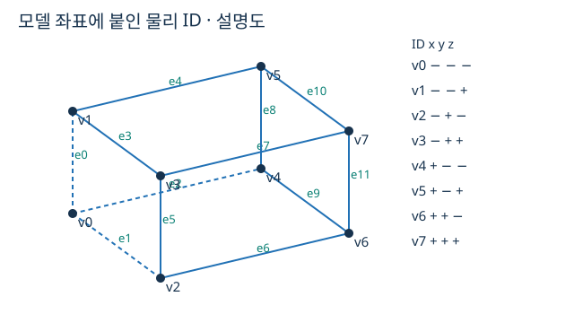
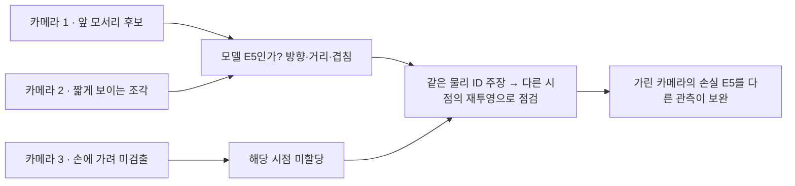

# 모서리 ID를 언제 믿을 수 있는가

물체 중심에 cartesian coordinate의 기준축을 두면 꼭짓점 위치는 $(\pm a/2, \pm b/2, \pm c/2)$이고, 부호에 따라 나열하면 12개 엣지가 된다. 카메라가 바뀌어도 이 번호는 물체에 붙어 있어야 한다. LSD(Line Segment Detection)의 local_id는 한 영상 프레임에서 어느 선분을 읽었는지 찾기 위해서 매겨졌다.

카메라 중심을 물체 좌표로 옮겨 상자 바깥쪽을 향하는 면의 법선과 비교한다. 인접한 두 면 중 하나가 카메라 쪽이고 깊이와 투영 길이가 충분한 선을 검색한다. 상자 자체의 가림을 설명하기 위해서인데, 손의 위치는 모델에 주어지지 않으므로 보여야 할 엣지가 실제로 검출되지 않을 때에는 미할당으로 분류하게 된다. [모델 번호와 가시성 코드](../../pose/fusion.py)

### 관측 하나의 비용

예상 모서리 양 끝을 $p_0,p_1$, 검출 선분을 $q_0,q_1$라 하자. 면의 경계에 잘린 선분 끝점은 물리 꼭짓점과 일치할 필요가 없다. 검출 방향에 수직인 단위벡터 $n$과 직선 위의 점 $\bar q$로 residue $r_j=n^T(p_j-\bar q)$를 얻는다. $\sqrt{(r_0^2+r_1^2)/2}$는 px 단위 수직 이탈이다. 각도는 $\arccos(|d_p^Td_q|)$로 양 끝 순서에 무관하게 계산한다. 평행하지만 한참 떨어진 조각을 걸러내기 위해 축 방향에 사영한 두 유한 구간의 겹침도 검사한다. 거의 0길이인 선은 방향 추정 자체가 불안정하다.

그림의 E5는 원리를 보여 주는 예시다. 같은 에지의 서로 다른 부분을 보는 두 영상도 ID를 공유할 수 있다. 반대로 두 카메라가 정확히 같은 표면 지점을 관측하는 비율은 별도 가시성 지표다.

### 일대일 할당과 분절의 긴장

Greedy는 가장 가까운 쌍부터 검토해서 빠르지만 첫 선택이 다음 후보에 대한 검토를 방해할 수 있다. Hungarian은 전체 할당비용 합을 최소화한다. 미검출·잡음을 허용하려면 금지된 조합과 미할당 dummy의 비용을 구분해야 한다. 하나의 모서리가 세 조각이면 일대일 제약은 조각 둘을 버릴 수 있다. 호환되는 조각을 유한 지지 구간으로 묶고 한 모서리의 가중치와 집계 횟수를 제한하는 이유다. 토폴로지(topology)는 모델 에지의 끝에 어떤 모델 꼭짓점이 접속하는지 알려준다. 실제 교점이 손 때문에 끊겼다면 접속 증거가 없다는 이유만으로 ID를 확정 또는 배제하면 위험하다. [IV 구현과 실제로 적용한 제약](../../evaluation/pose_benchmark/ALGORITHM_DESIGN.md)

### 정답 판단과 자기확증

샘플 영상을 이용한 엣지 매칭 실험 중, Phase III에서 B 배치의 원래 쌍 정밀도는 983/1,441(68.22%)였다. 같은 자세로 후검사하면 903/920(98.15%)로 올랐지만 쌍 재현율은 74.30%에서 68.25%로 내려갔다. 오답도 지웠지만 정답 80쌍도 지웠다. 해당 카메라를 빼고 자세를 구한 검사에서는 847/857이었다. 같은 관측을 적합과 검증에 모두 쓰면 스스로 만든 자세에 잘 맞는 오류를 발견하기 어렵다. 제외 시점 검사도 이전 자세와 보정을 공유하므로 완전한 통계적 독립을 제공하지 않는다. Phase IV는 이 검사 결과를 재적합에 넣었을 때 실제 자세와 가림 보완까지 좋아지는지 별도로 평가한다. [원시 쌍 집계](../../evaluation/edge_identity/results/summary.csv) · [IV 독립 비교](../../evaluation/pose_benchmark/ABLATION_STUDY.md)
