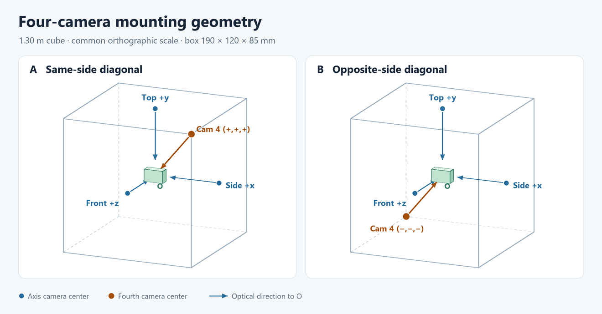

# 카메라를 어느 꼭짓점에 달 것인가

세 축 카메라의 중심은 오른손 Z-up에서 정면 −Y, 측면 +X, 상단 +Z다. A는 이 세 방향의 부호를 동시에 갖는 (+,−,+), B는 반대인 (−,+,−)이다. Phase I의 +Y 위·+Z 정면 좌표에서는 같은 배치가 각각 (+,+,+), (−,−,−)로 저장됐다. 변환은 (x,y,z) → (x,−z,y)다. 부호는 카메라 **위치**이며 광축은 중심을 향한다. [Phase I 카메라 함수](../../experiments/fusion/fusion_poc.py) · [Z-up 리그 생성](../../pose/synthetic_benchmark.py) · [8개 위치 설정](../../evaluation/layout_pose/results/manifest.json)

한 변 1.30 m인 예시 프레임에서 축 카메라의 중심 거리는 0.65 m, 꼭짓점 거리는 √3배인 1.126 m다. 초점거리가 같으면 대각 카메라에서 상자가 작아진다. 이에 따라 같은 거리 실험과 실제 꼭짓점 거리 실험을 분리했다. 공간 대각선이 축과 이루는 예각은 arccos(1/√3) ≈ 54.74°다. 수평 투영의 방위각 45°와 구분한다.

**현장 후보** (−,+,+)에서는 손 가림을 포함한 합성 조건의 동일 모서리 표본 2대 이상 가시율이 91.94%, (−,−,+)에서는 88.52%였다. 한 카메라 누락 시 최악 부분집합의 최소 고유값 p10은 뒤 후보가 약간 높았다. 하단 (−,+,−)은 간섭 없는 조건의 가시율 96.33%였지만 가정한 바닥 여유에서 설치할 수 없었다. 높은 가시율에도 거짓 선분이 남으므로 제작 결정에는 실제 물리 ID 정밀도, 잔차, 보드 보정 가능성이 모두 필요하다. [배치별 원시 결과와 가정](../../evaluation/LAYOUT_COMPARISON.md) · [체커보드 입사각과 현장 비교](../../rig/MOUNT_VALIDATION.md)
