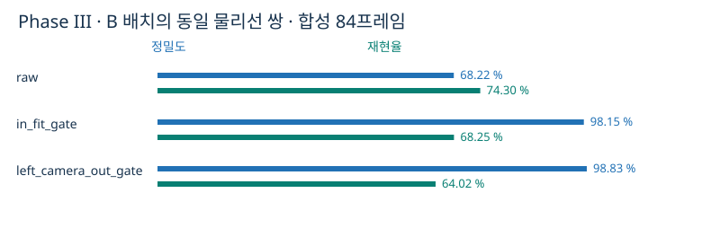

# 성능 수치를 읽는 순서

**질문을 먼저 고른다.** 분할 마스크가 상자를 포함하는지, 선분 두 개가 동일 물리 ID인지, 출력 자세가 독립 기준에 가까운지는 서로 다른 검증이다. GT가 없는 단일 녹화에서 마스크를 두 방법으로 비교한 IoU는 두 예측의 일치도다. 합성에서 GT를 아는 상황의 mm 오차는 실제 녹화에 대한 정확도로 옮길 수 없다.

| 실험과 모집단 | 관찰 | 해석할 때 고정해야 할 조건 |
|---|---|---|
| Phase I 상자 궤적, 세 잡음 시드 | 스트레스 조건의 코너+선에서 네 시점 A 위치 RMSE 약 0.665 mm, 공통 세 축 약 0.759 mm | 가까운 초기값, 보정된 동시 시점, 특정 코너 소실 구간 |
| Phase II 독립 시험, 자기 이전 자세, 결함 활성 483프레임 | All 3.85 mm·2.21°, Best Triple 2.00 mm·0.77°, 휴리스틱 재적합 22.07 mm·6.56° | 무효 상태에서 유지된 자세도 RMSE에 포함. 거부로 인한 이탈이 큰 차이를 만든다 |
| Phase III B 손 조건의 대응 후검사 | 모델에 맞는 쌍 정밀도 68.22% → 98.15%, 쌍 재현율 74.30% → 68.25% | 임계값 적용 전후에 자세를 고정했다. 이 실험만으로 자세가 개선됐다고 할 수 없다 |
| Phase IV 독립 비교 (3배치 × 15조건 × 2시드, 전체 1,620 / 활성 762프레임) | 전체 성공률 `phase2_all` 85.93% (오답 측정 9.73%), `cross_verify` 70.74% (오답 측정 0.00%, 활성 에지 F1 82.40%, 쌍 정확도 89.82%) | 각 방법의 자체 이전 출력 사용, 별도 dev/test 시드(53003·53017), 거부 유지 자세가 RMSE에 포함됨 |

[Phase I 원시 표](../../experiments/fusion/results/summary.csv) · [Phase II 자기 이전 자세 표](../../pose/results/autonomous_summary.csv) · [Phase III 후검사 집계](../../evaluation/edge_identity/results/summary.csv) · [Phase IV 독립 시험 집계](../../evaluation/pose_benchmark/results/primary/summary.csv) · [Phase IV 재획득 집계](../../evaluation/pose_benchmark/results/primary/recovery.csv)

### Phase IV 독립 시험 전체 집계

독립 시험 시드(`53003`, `53017`)에서 세 배치(`x-y+z+`, `x-y-z+`, `x-y+z-`)와 15개 조건(정상·자기가림·외부가림·잘못된 에지 ID·코너 누락·분절·단일/복수 카메라 오류·보정/시각 오류·급회전·재획득·복합 결함·단일 시점·평행 에지)을 합산한 결과다. 각 방법은 최초 1회 거친 초기 자세만 공유하고 이후 자체 마지막 유효 측정으로 진행한다.

#### 전체 구간 (1,620프레임 합산, `pooled / all_frames`)

| 방법 | 에지 F1 | 쌍 정확도 | 추적 성공 | 오답 측정 (유효 대비) | 위치 / 회전 RMSE | CPU p50 / p95 |
| --- | ---: | ---: | ---: | ---: | ---: | ---: |
| `phase2_all` | 84.95% | 88.01% | 85.93% | 9.73% (150/1,542) | 29.45 mm / 32.85° | 6.08 / 13.72 ms |
| `phase2_best` | 70.08% | 91.96% | 71.91% | 0.43% (5/1,170) | 21.12 mm / 33.43° | 25.61 / 58.93 ms |
| `cross` | 77.98% | 88.36% | 70.74% | 0.00% (0/1,146) | 21.35 mm / 34.06° | 36.25 / 85.15 ms |
| `cross_verify` | 80.92% | 91.96% | 70.74% | 0.00% (0/1,146) | 21.36 mm / 34.06° | 50.28 / 129.74 ms |
| `cross_alternating` | 80.87% | 91.69% | 70.74% | 0.00% (0/1,146) | 21.36 mm / 34.06° | 53.24 / 140.44 ms |
| `oracle_all` (GT ID) | 100.00% | 100.00% | 96.11% | 1.33% (21/1,578) | 6.31 mm / 6.92° | 3.08 / 7.58 ms |

#### 결함 활성 구간 (762프레임 합산, `pooled / active`) 및 재획득 (30사건)

| 방법 | 활성 에지 F1 | 활성 쌍 정확도 | 활성 추적 성공 | 활성 오답 측정 | 활성 위치 / 회전 RMSE | 손 가림 복구 (170건) | 재획득 성공 (30건) |
| --- | ---: | ---: | ---: | ---: | ---: | ---: | ---: |
| `phase2_all` | 81.18% | 78.71% | 82.15% | 10.57% (74/700) | 25.01 mm / 29.54° | 45.88% (78) | 18 / 30 |
| `phase2_best` | 70.07% | 82.14% | 67.85% | 0.96% (5/522) | 12.23 mm / 32.40° | 32.35% (55) | 7 / 30 |
| `cross` | 77.04% | 81.35% | 66.14% | 0.00% (0/504) | 12.29 mm / 32.42° | 31.18% (53) | 6 / 30 |
| `cross_verify` | 82.40% | 89.82% | 66.14% | 0.00% (0/504) | 12.30 mm / 32.42° | 34.12% (58) | 6 / 30 |
| `cross_alternating` | 82.28% | 89.12% | 66.14% | 0.00% (0/504) | 12.30 mm / 32.42° | 34.12% (58) | 6 / 30 |
| `oracle_all` (GT ID) | 100.00% | 100.00% | 91.73% | 2.92% (21/720) | 9.19 mm / 10.10° | 70.00% (119) | 30 / 30 |

**핵심 해석.** 교차 시점 검증 계열(`cross`, `cross_verify`, `cross_alternating`)은 독립 시험 1,620프레임 전체에서 오답 측정을 **0건**으로 억제했고, `cross_verify`는 활성 구간 에지 F1을 `phase2_best`(70.07%) 대비 **82.40%**, 쌍 정확도를 **89.82%**까지 끌어올렸다. 반면 엄격한 지지 조건으로 인해 복수 카메라 오류·급회전·복합 결함에서 측정을 거부하고 이전 자세를 유지하면서 전체 추적 성공률(70.74%)과 재획득 성공률(6/30)은 `phase2_all`(85.93%, 18/30)보다 낮았고 CPU p95 비용(129.74 ms)도 커졌다. 개발 절제와 프로토콜 세부 내용은 [개발 절제 실험](../../evaluation/pose_benchmark/ABLATION_STUDY.md) · [벤치마크 설계](../../evaluation/pose_benchmark/BENCHMARK_PROTOCOL.md)에서 확인할 수 있다.

### 대표 실패를 어떻게 설명할까

Phase II 시험 `test-simultaneous-01` 20번 프레임에서 전체 시점 적합은 네 카메라를 지지 시점으로 보고 유효 자세를 출력했지만 위치 오차는 33.54 mm, 회전 오차는 22.70°였다. 참 물리선들을 관측해도 두 대에 동시 오류가 있으면 공동 자세가 틀릴 수 있다. 다른 실패 유형은 자세를 계속 거부하며 다음 검색 중심이 실제 물체와 멀어지는 경우다. 같은 실패율 숫자라도 어느 쪽이 많은지에 따라 개선 방법은 달라진다. [실패 프레임 CSV](../../pose/results/autonomous_failure_examples.csv) · [IV 실패 사례](../../evaluation/pose_benchmark/FAILURE_ANALYSIS.md)

**지표 읽기.** 정밀도는 주장한 것 중 정답, 재현율은 가능한 정답 중 회수된 비율이다. F1은 두 비율의 조화평균이다. 카메라 쌍 기준과 검출 조각 기준은 분모가 다르며 분절된 조각 수만 늘려 물리 모서리 복원율을 높게 보이게 해서는 안 된다. 자세 오차는 측정 출력 비율과 함께 읽는다. 미출력 프레임이 많고 유효 출력만 평균낸 알고리즘이 더 정확해 보일 수 있다. 실패 후 관측 종료까지 복구되지 않은 사례도 재획득 분모에 남겨야 한다.
