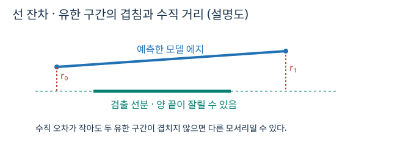
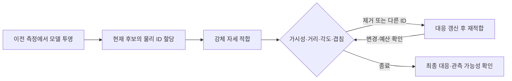
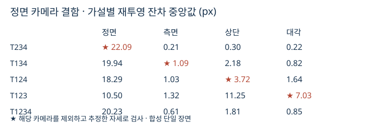
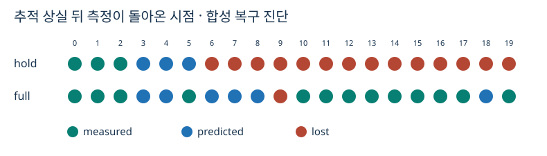

# 잔차가 작아도 오답일 수 있는 세 장면

### 자기확증과 재할당

LSD가 같은 방향의 테이프 경계와 상자 모서리를 함께 검출했다고 하자. 잘못 고른 테이프에 자세를 먼저 맞추면 같은 영상에서 다시 잰 잔차도 작아질 수 있다. 아래 그림에서 빨간 거리는 모델 투영과 검출 선분을 비교한 양이다. 정답 에지 ID는 별도로 표기해야 검증할 수 있다.

회전 대칭으로 다른 ID 집합이 같은 모양을 만들면 여러 시점의 잔차도 동시에 작을 수 있다. 명시적인 초기 방향, 비대칭 표면 특징 또는 방향 마커가 없다면 물체 축의 절대 부호는 보장할 수 없다. 시간 연속성은 직전 측정이 정확할 때 도움을 준다. [구현 수식과 중단 조건](../../evaluation/pose_benchmark/ALGORITHM_DESIGN.md)

### 제외한 카메라도 고장 날 수 있다

정면을 제외한 세 카메라에 잘 맞는 가설이 정면 영상에서 22.10 px 어긋났다. 정면에 체계적 오류를 넣은 장면이므로 제외 잔차가 큰 가설을 무조건 버리면 유용한 가설을 잃는다. 어떤 카메라가 고장 났는지는 시뮬레이터의 평가 정보다. 추정기가 보는 것은 지지 관측 수, 잔차와 시간 변화뿐이다. [원시 행렬](../../evaluation/pose_benchmark/results/recovery_diagnostic/summary.json)

### 관측이 끊긴 동안 자세를 계속 출력하는 경우

한 20프레임 시나리오에서 전체 복구 정책은 다시 보이는 첫 프레임에서 PnP로 위치를 찾았지만 그 갱신에 약 2.30초가 걸렸다. 또 거의 평행한 선의 끝점에 0.05 px 잡음을 추가하자 정보행렬 랭크가 6이 되어 약한 자세를 승인했다. 그 프레임의 위치 오차 6.69 mm는 실험의 실패 문턱인 20 mm보다 작았다. 즉, 실패율 표만 봐서는 불확실한 자세를 승인한 이 사례를 찾기 어렵다. [프레임별 측정](../../evaluation/pose_benchmark/results/recovery_diagnostic/recovery_frames.csv) · [복구 진단과 해석](../../evaluation/pose_benchmark/HYPOTHESES_AND_RECOVERY.md)

이 그림들은 [생성 코드](../../evaluation/pose_benchmark/render_guide_figures.py)로 재현한다. 여러 시드에서 같은 현상이 얼마나 흔한지는 [독립 시험](../../evaluation/pose_benchmark/ABLATION_STUDY.md)과 [실패 분석](../../evaluation/pose_benchmark/FAILURE_ANALYSIS.md)을 참조한다.
