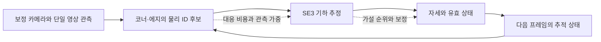

# Quadpose 학습 연구 · D0

네 카메라의 영상에서 물리적으로 같은 에지를 식별하고, 한 시점에서 가려진 에지를 다른 시점에서 보완하는 것이 팀의 요구다. 추정기는 알려진 직육면체의 8개 꼭짓점과 12개 모서리를 재투영해 세계 좌표에서 하나의 6DoF 자세를 출력한다. 학습 모듈은 대응, 관측 선택 또는 갱신 중 어디에 이득이 있는지 시험하는 후보로 둔다.

**기본 실험 환경은 Z-up Layout A**다. 앞과 옆, 위 카메라의 위치 방향은 각각 `(0,-1,0)`, `(+1,0,0)`, `(0,0,+1)`이고 대각 카메라는 `(+1,-1,+1)`이다. 모든 광축은 작업 공간 중심을 향한다. 기하 벤치마크의 이전 Phase IV 세 대각 후보는 이 기본 배치와 다르다. 현재 수치와 이전 연구는 각 설정과 함께 읽는다. 실물에서는 합성 카메라를 보정된 리그로 교체한다. [정량 비교](BASELINE_AND_ORACLE_ANALYSIS.md) · [기존 배치 연구](../../../evaluation/layout_pose/README.md)



위 그림은 연구 후보를 연결한 설명도다. Studio의 제품 추정 경로는 현재 기하 기준을 사용한다.

| 질문 | 자료 |
|---|---|
| 기존 구현과 입력 계약은 어떻게 동작하는가? | [코드와 계약](CODEBASE_AUDIT.md) · [데이터 설계](DATASET_DESIGN.md) |
| 12개 후보의 선행연구와 비용은 무엇인가? | [방법 조사](METHODOLOGY_SURVEY.md) · [비교표](METHOD_COMPARISON.md) |
| 모델이 올바른 에지, 가중치 또는 가설을 알면 얼마나 좋아지는가? | [Layout A와 Oracle](BASELINE_AND_ORACLE_ANALYSIS.md) |
| 어떤 작은 모델을 운영해 보았는가? | [지도 학습](SUPERVISED_LEARNING.md) · [자기지도·증류·시간축](SELF_SUPERVISED_LEARNING.md) · [순차 정책](REINFORCEMENT_LEARNING.md) · [모델과 체크포인트](../../../learning/MODEL_REGISTRY.md) |
| 무엇을 확대할 만한가? | [실험 결과](EXPERIMENTAL_RESULTS.md) · [실패 분석](FAILURE_ANALYSIS.md) · [후속 선정](CANDIDATE_SELECTION.md) · [자원](RESOURCE_REPORT.md) |

## 사용 범위

기하 관측을 사용하는 D0는 수치 데이터만 생성한다. RGB 렌더링, 온라인 적응과 대규모 훈련은 소규모 결과에 따라 후속으로 검토한다. 팀의 마커 정책은 별도 의사결정이다. 실물 4대 동기 촬영과 독립 자세 기준이 확보되면 두 장치 이상의 실제 가림 보완과 같은 검증을 반복한다. [실물 가이드](../../guide/15_PHYSICAL_VALIDATION.md)

작업 디렉터리는 저장소 루트다. PyTorch와 OpenCV가 있는 기존 환경으로 아래 명령을 실행한다. 상세 시드, 모델 ID, 파일과 명령은 각 실험 보고서를 참조한다.

```powershell
$env:OPENBLAS_NUM_THREADS = '1'
$env:OMP_NUM_THREADS = '1'
$py = '.\.venv\Scripts\python.exe'
& $py -B -m unittest discover -s learning -t .
& $py -B -m experiments.neural.policy_study --output outputs/neural/replay_new --limit 16
& $py -B -m experiments.neural.residual_study --output outputs/neural/residual_new --temporal --cuda
```

`--cuda`는 작은 지도 보정 모델의 비교 한 건을 추가한다. CPU-only 재현에는 이 옵션을 생략한다. 정책의 독립 D0 재현은 `--eval-split lockbox`를 지정한다. `--resume-rl`에 기존 `reinforce.pt`를 전달하면 가중치에서 재시작하며 새 Adam 상태를 사용한다. 대용량 원시 데이터와 정책·보정 체크포인트는 Git에서 제외되는 `outputs/` 아래에 생성한다. 비교에 필요한 집계·검증 메타데이터와 소형 NumPy 가중치를 연구 브랜치에 보존한다.
