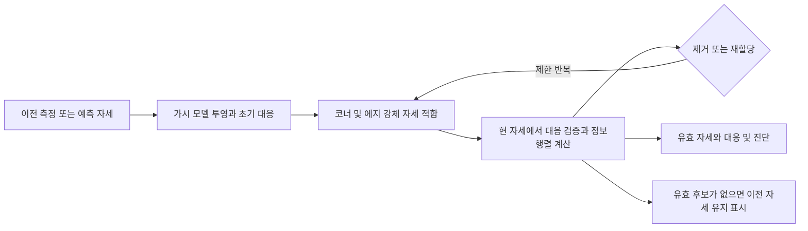

# Phase IV 기하 추정기 설계

## 문제와 범위

하나의 물리 에지는 각 영상에서 다른 방향과 길이의 선분으로 검출된다. 가림이 있으면 검출기가 한 에지를 여러 조각으로 나눌 수도 있다. 영상 좌표만 비교해 다른 시점의 선분을 연결하기는 어렵다. 이 추정기는 알려진 직육면체를 각 카메라에 현재 자세로 투영하고, 영상마다 검출을 공통 모델 에지 ID에 연결한다. 한 시점이 에지를 잃었을 때 다른 시점의 같은 ID가 최적화에 계속 잔차를 공급할 수 있다.

입력은 미리 왜곡을 보정한 코너 후보와 유한 선분, 카메라 내부·외부 파라미터, 모델 세 변의 길이, 이전 예측 자세다. 합성 정답 ID와 정답 자세는 평가기에만 들어간다. 좌표계는 Z-up이며 정면, 측면, 상단 방향은 각각 −Y, +X, +Z다. 구현은 [Phase II 투영·SE(3) 최적화](../../pose/fusion.py)를 호출하는 [독립 Phase IV 모듈](../../pose/refinement.py)에 있다. Phase II에서 기록된 All-camera·Best Triple과 새 방법의 성능은 벤치마크에서 각각 독립 초기화 이후 자체 추정 이력을 사용해 비교한다.



## B01 및 B03 · 물리 에지 검증과 대응

물체 좌표의 꼭짓점 $X_o$는 $X_w=RX_o+t$로 세계 좌표에 놓인다. 세계→카메라 회전 $R_c$, 세계 좌표 카메라 중심 $C_c$, 내부행렬 $K_c$를 쓰면 영상점은 $\pi(K_cR_c(X_w-C_c))$다. $\pi$는 마지막 동차 좌표로 나눈다. 알려진 직육면체의 에지 ID는 한 부호만 다른 두 꼭짓점 ID로 정의된다. 적어도 하나의 인접 면이 카메라를 향하고, 끝점이 센서 안의 양의 깊이에 있으며, 충분한 영상 길이가 남은 모델 에지만 대응 후보가 된다. 직육면체 자체 가림을 설명하는 검사이며 손처럼 외부에서 가리는 물체는 검출의 소실이나 조각화로 나타난다.

투영 모델 선분의 시작점을 $a$, 길이를 $L$, 단위 방향과 법선을 $u,n$이라 하자. 검출 선분의 두 끝점 $p,q$를 모델 방향으로 사영하면 $I=[\min(u^\top(p-a),u^\top(q-a)),\max(u^\top(p-a),u^\top(q-a))]$를 얻는다. 겹침 $o=|I\cap[0,L]|$는 에지마다 픽셀로 계산한다. 모델과 검출이 같은 무한 직선 위에 있어도 거리가 멀어 $o=0$이면 거부한다. 방향은 LSD 끝점 순서에 무관하도록 $\arccos|u^\top v|$를 사용한다.

| 검사 | 기본 후보 기준 |
|---|---|
| 수직 거리 | 두 검출 끝점의 모델 선에 대한 절대 거리 평균 8 px 이하 |
| 방향 차 | 방향 부호를 무시한 각도 20° 이하 |
| 유한 겹침 | 6 px 이상이며 두 사영 구간 중 짧은 길이의 48% 이상 |
| 모델 토폴로지 | 신뢰도 높은 대응 코너에 닿는 끝점은 물리 에지의 단말 꼭짓점과 일치해야 함 |
| 가시성 | 카메라별로 가시한 모델 에지만 허용 |

토폴로지는 관측 끝점이 대응 코너로부터 6 px 이내이며 투영 에지 끝점 부근에 있을 때만 적용한다. 두 조건이 성립하면 모델 에지에 실제로 연결되는 꼭짓점인지 확인한다. 코너가 없는 가림 조각은 다른 기하 검사를 통과하면 후보로 남는다. 코너가 강한 오대응이면 토폴로지 검사도 잘못된 판단을 할 수 있어 `Config(topology=False)`로 비교할 수 있다.

Greedy는 낮은 비용부터 모델과 검출 하나를 연결한다. Hungarian은 전체 모델–검출 비용과 모델마다 하나씩 추가한 미할당 더미 비용의 합을 최소화한다. 금지된 후보는 더미보다 큰 비용을 갖는다. 어떤 모델도 검출을 강제로 받지 않으며 남은 검출은 그대로 미할당이다. Phase II의 기존 greedy 대응은 `edge_mode="legacy"`로 확인할 수 있다. 유한 구간 등의 새 에지 비용에서 `assignment="hungarian"`과 `"greedy"`를 비교한다. Legacy 에지 경로 자체는 원래 greedy를 사용한다.

일대일 주 대응 후에는 이미 할당된 에지에 서로 과도하게 겹치지 않는 여분 검출 조각을 최대 세 개까지 연결한다. 겹침은 짧은 조각의 25% 이하여야 하고 가장 가까운 기존 조각과의 간격은 24 px 이하여야 한다. 각 원본 관측은 한 물리 에지에만 속한다. 한 카메라의 같은 에지로 할당된 점들은 total least squares로 하나의 지지선으로 묶어 최적화한다. 따라서 같은 물리 에지의 조각 여러 개가 독립 에지 여러 개만큼 정보행렬을 부풀리지 않는다. 결과에는 합치기 전 `(model_id, observation_index)`를 보존한다.

적합 뒤에는 갱신된 자세로 가시성과 토폴로지, 유한 겹침을 다시 계산한다. 검증 시 선 거리와 각도 문턱은 초기 대응보다 좁다. `point_pairs`와 `edge_pairs`는 자세 계산에 실제 사용한 대응이고, `verified_point_pairs`와 `verified_edge_pairs`는 사후 검사에 남은 그 부분집합이다. 이 검사는 적합에 사용한 영상 관측도 재사용한다. 최적화가 오대응에 맞춰 이동하면 잘못된 ID도 낮은 잔차를 보일 수 있다. 물리 ID 정확도는 별도 정답으로 판정한다. 제외 시점에 대한 교차 평가도 도움이 되지만 그 시점이 고장 나거나 가려진 경우 큰 잔차만으로 정상적인 가설을 거부할 수 없다.

## B02 · 대응과 자세의 교대 갱신

상태는 대응 집합 $A$와 물체→세계 자세 $T=(R,t)\in SE(3)$다. 코너의 잔차는 검출 픽셀과 투영 모델 꼭짓점의 두 좌표 차다. 에지의 잔차는 관측 지지선에 대한 투영 모델 양 끝점의 부호 있는 법선 거리다. 짧은 검출 조각의 끝점을 물체의 실제 꼭짓점으로 해석하지 않는다. Phase II의 감쇠 Gauss–Newton과 Huber 손실을 사용하며 지수좌표 갱신으로 $R\in SO(3)$를 유지한다.

| `method` | 단계 |
|---|---|
| `baseline` | 초기 자세에서 한 번 대응하고 최적화 |
| `removal` | 초기 적합 뒤 엄격한 사후 검증을 통과한 대응만 남겨 한 번 재최적화 |
| `reassignment` | 초기 적합 자세에서 전체 영상 관측을 다시 대응한 뒤 한 번 재최적화 |
| `alternating` | 대응 갱신과 재최적화를 교대하며 기본 최대 세 번의 추가 적합 |

후보 비교에는 고정된 원시 관측 개수 $N$을 분모로 사용한다. 원시 대응이 있는 스칼라 잔차 $r$에는 절단점을 3 px로 하는 Huber 손실 $\rho_3$을 적용하고, 미할당 관측 하나당 기본 비용 16을 더한다.

$$
E(A,T) = \frac{\sum_{r\in R(A,T)}\rho_3(r)+16(N-|A|)}{\max(1,N)}.
$$

누락 비용은 잔차가 큰 대응만 제거해 목적값을 낮추는 경향을 줄인다. 대응 단계의 거리·각도·겹침 비용은 이 식의 정확한 전역 최소화가 아니며, 자세 적합 단계는 병합된 에지당 하나의 지지선을 사용한다. 따라서 새 후보는 공통 점수로 다시 검사하고 유효성과 관측 보존 조건을 함께 적용한다. 새 해가 점수 허용 오차 $10^{-3}$를 넘겨 악화되거나 초기 대응 수의 40% 미만을 남기면, 그 프레임의 이전 유효 후보를 유지한다. 물리 ID 전체의 변경률은 두 대응 집합의 대칭차 크기를 합집합 크기로 나눈다.

동일한 대응에서 자세 변화가 0.20 mm와 0.10° 이하이고 점수 변화도 작으면 수렴으로 기록한다. 이전에 수락한 대응으로 돌아가는 비연속 반복은 순환으로 중지한다. 기본 100 ms는 프레임 단위 협력형 시간 예산이다. 실행 중인 수치 연산은 선점하지 않으므로 실제 시간은 한 단계만큼 넘길 수 있다. 예산 안에서 유효한 현 프레임 후보가 존재하면 이를 유지한다. 유효 후보가 없으면 전달받은 `last_valid` 또는 입력 자세를 반환하고 `valid=False`로 표시한다. 이때 대응과 정보행렬은 거부된 후보의 진단이며 유지 자세가 새 측정값이 되지는 않는다. `history`와 `stage_ms`에 목적값, 대응 변경률, 자세 증분, 중지 사유 및 CPU 단계 시간이 남는다.

## B04 · 시점 부분집합의 교차 평가

[부분집합 평가기](../../pose/hypotheses.py)는 공통 예측 자세로 얻은 영상 대응을 고정한 뒤 네 가지 3-of-4 적합과 전체 적합을 구한다. 행은 제외한 시점, 열은 검사한 시점이다. 적합에 쓴 세 시점의 잔차와 제외 시점에 투영한 잔차를 구분한다. 각 시점의 특징 수, 7 px 이하 잔차의 수, 지지도 따로 남긴다. 새 자세로 다시 대응했을 때의 안정성은 초기·갱신 대응의 Jaccard 유사도로 기록한다. 제외된 시점에는 자체 적합을 하지 않은 모델을 투영하므로 사후 자기확증에 대한 별도 근거가 생긴다. 다만 모든 부분집합이 일부 시점과 예측 자세를 공유하므로 가설의 오류는 상관될 수 있다.

기존 Best Triple의 기준은 부분집합 내부 RMS와 조건수다. 새 교차 선택인 `cross`는 랭크 6과 세 내부 시점의 지지를 요구하고 내부 재투영 오차, 관측량, 조건수, 예측 자세와의 거리, 대응 안정성을 조합한다. 제외 시점이 모델을 독립 지지하면 점수가 소폭 좋아진다. 제외 시점이 없거나 잔차가 커도 그 이유만으로 정상적인 내부 적합을 탈락시키지는 않는다. `cross_verify`와 `cross_alternating`은 선택된 적합 시점 범위에서 각각 대응 제거 또는 교대 정제를 적용한다. 제외 시점의 지지 기록은 교차 평가 근거이며 적합에 사용한 시점 목록은 `fit_views`에서 확인한다.

## B05 · 최종 관측 가능성

카메라 수를 늘려도 남은 특징이 같은 자유도만 제약하면 자세는 유일하지 않다. 예를 들어 여러 시점에서 모두 평행한 물리 에지의 지지선만 남으면 공통 에지 방향 병진이 관측되지 않을 수 있다. 반대로 잘 분포된 꼭짓점과 여러 방향의 에지가 있으면 보정된 단일 카메라에서 알려진 물체의 국소 자세를 결정할 수 있다. 두 경우 모두 임계값은 카메라 수보다 최종 잔차의 미분으로 판정한다.

회전 미분을 물체 중심으로 옮기고 병진을 상자의 공간 대각선 $L_b=\lVert(s_x,s_y,s_z)\rVert_2$로 나누어 $q=[\delta t/L_b,\delta\theta]$를 계산한다. Phase II의 세계 기준 왼쪽 증분에서 얻은 Jacobian을 $[J_\omega,J_v]$로 분리하면 최종 정규화 Jacobian은 다음과 같다.

$$
J_q = [L_b J_v, \ J_\omega + J_v[t]_\times].
$$

사후 최적화 자세에서 $H=J_q^\top WJ_q/160$을 다시 계산한다. $W$는 잔차별 Huber IRLS 가중치다. 160은 네 카메라에서 최대 $4(2\times8+2\times12)$개의 스칼라 잔차를 쓸 때의 고정 분모여서 적은 카메라를 쓸 때 정보량 감소를 가리지 않는다. 최소 고윳값이 나타나는 단위 고유벡터는 가장 약하게 제약되는 정규화 자세 방향이다. 그 방향과 $H$의 대각 원소, 유효 랭크, 최소 고윳값, 조건수, 카메라별 코너·서로 다른 에지·에지 조각 수, 물체 축별 물리 에지 분포를 반환한다.

기본 유효 조건은 수치 랭크 6, 최소 고윳값 0.75 이상, 조건수 20,000 이하, 전체 잔차 RMS 12 px 이하, 유의미한 관측 집합 한 개 이상이다. 각 시점의 지원은 병합 후 최소 세 특징과 특징 잔차 중앙값 6 px 이하로 정의한다. 이는 이 프로젝트의 실험 문턱이다. 정보행렬은 선택된 대응과 모델 근처의 국소 기하를 나타낸다. 3-of-4 정책을 별도로 비교할 때는 `Config(min_views=3)`를 적용할 수 있다. 부분집합 선택기의 정보는 B05와 스케일이 다르다. [부분집합 코드](../../pose/hypotheses.py)의 정보행렬은 물체 대각선으로 병진만 정규화하고, 고정 분모를 적용하지 않으며, 가중 Jacobian의 조건수를 보고한다. 두 모듈의 고윳값 및 조건수 문턱은 각각의 정의로 비교한다.

## B06 · 측정, 예측과 재획득

 Phase II에서 손실 프레임마다 자세를 유지하면 실제 물체가 검색 영역을 빠져나가고 이후 대응도 실패할 수 있었다. [복구 추정기](../../pose/recovery.py)는 마지막 두 측정만 사용한 병진·회전 외삽, 실패 횟수에 따른 검색 확대, 최대 여섯 개의 국소 자세 후보, 영상 사각형과 알려진 상자 면을 대응하는 IPPE 기반 PnP, 관측 가능한 1·2시점 적합을 개별 또는 조합 정책으로 비교한다. PnP 후보는 다른 시점의 지지와 강체 적합을 통과해야 한다. 무표식 직육면체 대칭 때문에 재투영이 좋은 자세가 물리 자세의 방향까지 옳다고 결론 내릴 수는 없다.

`measured`는 관측 검사에 통과해 추적 이력에 들어간다. `predicted`는 측정이 거부된 뒤 표시용으로 제한 시간 동안 반환하는 예측이며 `valid=False`다. 예측 허용 구간이 끝나면 `lost`를 표시한다. 유효 측정이 다시 들어오면 `reacquired`를 기록한다. 복구 정책은 정답 자세나 인공 마커 없이 작동하되, 시퀀스의 시작에 별도 입력 자세를 공급하는 실험과 입력 없이 PnP를 시도하는 경로는 서로 구분한다.

## 실행과 확인

```powershell
python -B -c "from evaluation.resource_limits import limit_process; limit_process(1,3); import unittest; unittest.main(module='pose.test_refinement',verbosity=2)"
```

[독립 테스트](../../pose/test_refinement.py)는 완전탐색과 Hungarian 비교, 유한 선분·토폴로지 검사, 조각 병합, 최종 검증 부분집합, 정규화 Jacobian 차분 검사, 충분한 1·2시점 및 평행 에지만 있는 4시점 조건, 순환·과도한 삭제·시간 초과 시 유효 상태 보존을 검사한다. 실제 대응률과 자세 오차, 계산 시간은 합성 벤치마크와 평가 표로 확인한다.
