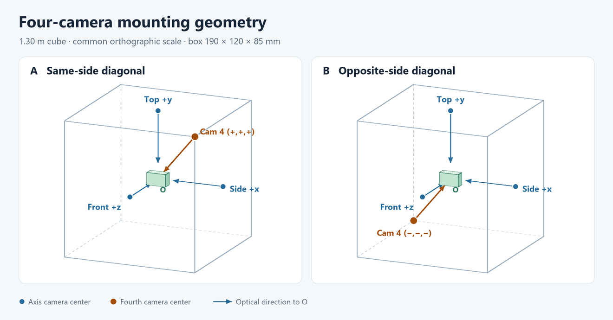

# 대각 카메라 배치와 손 접근 방향

한 변 1.30 m 정육면체 프레임의 중심을 원점에 뒀다. +x는 측면, +y는 상단, +z는 정면이다. 세 축 카메라를 각각 +0.65 m 면 중심에 놓고, 네 번째 카메라를 A는 (+0.65, +0.65, +0.65) m, B는 (−0.65, −0.65, −0.65) m에 놓았다. 모든 카메라는 원점을 향한다.



두 배치에 동일한 190×120×85 mm 직육면체의 81개 자세를 사용했다. 중심·축 정렬 정지 상태로 시작해 최대 45 mm 축별 이동과 x/y/z 축 회전 진폭 22°/28°/18°를 적용했다. 손은 반지름 85 mm의 불투명 구로 모델링했다. 세 축 카메라가 있는 (+,+,+) 쪽과 반대인 (−,−,−) 쪽의 동일 대각 방향으로 각각 접근시키고, 물체의 접근 방향 지지 평면과 구 사이 간격을 8–50 mm로 바꿨다. 두 배치는 같은 손 경로를 사용한다. 가림은 카메라와 특징점을 잇는 선분이 구와 만날 때 적용한다. 상자 자체 가림도 반영한다.

```powershell
python experiments/mount_occlusion/visibility_sweep.py --output experiments/mount_occlusion/results
python experiments/mount_occlusion/render_mounts.py
```

### 결과

81개 자세에서 꼭짓점 8개와 모서리마다 균등하게 뽑은 내부 표본 41개를 대상으로 평균을 계산했다. 아래 비율은 **같은 특징점**을 각각 1대 이상, 2대 이상에서 보는 비율이다. 모서리 비율은 표본의 비율이며 모서리마다 가중치는 같다.

| 손 방향 | 배치 | 꼭짓점 1대+ | 꼭짓점 2대+ | 모서리 표본 1대+ | 모서리 표본 2대+ |
| --- | --- | ---: | ---: | ---: | ---: |
| 없음 | A | 99.07% | 98.46% | 97.63% | 89.71% |
| 없음 | B | 100.00% | 99.07% | 100.00% | 97.63% |
| 축 카메라 쪽 (+,+,+) | A | 99.07% | 96.60% | 97.63% | 82.20% |
| 축 카메라 쪽 (+,+,+) | B | 100.00% | 99.07% | 100.00% | 97.52% |
| 반대쪽 (−,−,−) | A | 99.07% | 98.46% | 97.63% | 89.71% |
| 반대쪽 (−,−,−) | B | 99.07% | 97.22% | 97.79% | 83.65% |

중심에 축 정렬된 자세의 무가림 검산은 A에서 꼭짓점 7/8과 모서리 9/12를 1대 이상 및 2대 이상에서 보였다. B에서는 1대 이상이 8/8 및 12/12, 2대 이상이 7/8 및 9/12였다. 움직임을 포함한 평균에서는 손이 축 카메라 쪽에서 접근할 때 B의 2대 이상 모서리 가시율이 A보다 15.32%p 높았다. 반대쪽 접근에서는 A가 B보다 6.06%p 높았다. 2대 이상 가시율은 시점 확보 여부를 나타낸다. 실제 자세 오차는 보정, 특징 대응, 관측 각과 픽셀 분해능의 영향을 받는다.

이 모델은 카메라 시야각·왜곡, 프레임 기둥, 바닥, 손가락이나 손목 모양 및 실제 검출 실패를 생략했다. 실제 설치에서는 두 방향의 손 접근과 가림을 반복해 동일 지표와 자세 오차를 측정한다. [요약 CSV](results/summary.csv) · [프레임별 CSV](results/per_frame.csv)
